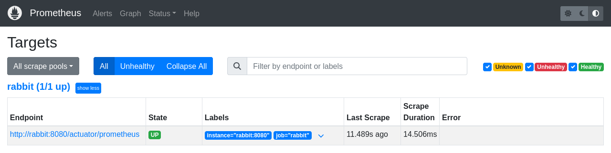
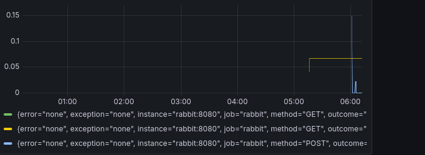
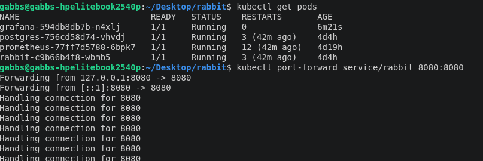

[](https://github.com/gabbs234/rabbit/actions/workflows/build.yml)

# Rabbit

A task manager REST API built with Spring Boot, secured with JWT authentication and backed by PostgreSQL. It is containerized with Docker, runs on Kubernetes (kind), exposes metrics to Prometheus and Grafana, and is built, tested and published automatically with GitHub Actions.

## Features

- User registration and login
- Stateless authentication with JWT (token sent in the `Authorization` header)
- Create and list tasks, stored in PostgreSQL and scoped to the logged-in user
- Passwords hashed and routes protected with Spring Security
- Automated tests running against a real PostgreSQL in CI
- Docker image published to GitHub Container Registry on every push to `master`
- Runs on Kubernetes with a persistent volume for the database
- Metrics exposed with Spring Boot Actuator and Micrometer, scraped by Prometheus and charted in Grafana
- Secrets and configuration supplied through environment variables

## Tech Stack

| Layer | Technology |
|-------|------------|
| Language | Java 21 |
| Framework | Spring Boot, Spring Data JPA |
| Security | Spring Security, JWT (jjwt) |
| Database | PostgreSQL |
| Build | Maven |
| Containers | Docker, Kubernetes (kind) |
| Monitoring | Micrometer, Prometheus, Grafana |
| CI/CD | GitHub Actions, GitHub Container Registry |

## Architecture

Rabbit and PostgreSQL each run as a pod in a Kubernetes cluster, and each sits behind a Service, so other pods reach them by name (`rabbit`, `postgres`) instead of by changing IP addresses. PostgreSQL stores its data on a PersistentVolumeClaim, so the data survives pod restarts. Prometheus scrapes rabbit's `/actuator/prometheus` endpoint every 15 seconds, and Grafana reads from Prometheus to draw dashboards.

```
 client ──► Service: rabbit ──► Pod: rabbit ──► Service: postgres ──► Pod: postgres ──► volume
                                     ▲
              Pod: prometheus ───────┘  (scrapes /actuator/prometheus)
                    ▲
              Pod: grafana (dashboards)
```

## API Endpoints

| Method | Path | Auth | Description |
|--------|------|------|-------------|
| POST | `/auth/register` | No | Create a new user |
| POST | `/auth/login` | No | Log in and receive a JWT |
| GET | `/tasks` | Yes | List your tasks |
| POST | `/tasks/add` | Yes | Create a task |
| GET | `/actuator/prometheus` | No | Metrics for Prometheus |

## Example

These examples assume the app is running at `http://localhost:8080`.

Register a user:

```bash
curl -X POST http://localhost:8080/auth/register 
  -H "Content-Type: application/json" 
  -d '{"username":"john","password":"secret123"}'
```

Log in and copy the token from the response:

```bash
curl -X POST http://localhost:8080/auth/login 
  -H "Content-Type: application/json" 
  -d '{"username":"john","password":"secret123"}'
```

Create a task:

```bash
curl -X POST http://localhost:8080/tasks/add 
  -H "Authorization: Bearer YOUR_TOKEN" 
  -H "Content-Type: application/json" 
  -d '{"title":"Write my README"}'
```

List tasks:

```bash
curl http://localhost:8080/tasks 
  -H "Authorization: Bearer YOUR_TOKEN"
```

## Run Locally

### Prerequisites

- JDK 21
- Maven
- PostgreSQL

### Setup

1. Clone the repository:

   ```bash
   git clone https://github.com/gabbs234/rabbit.git
   cd rabbit
   ```

2. Create a PostgreSQL database named `rabbit`.

3. Set the environment variables:

   | Variable | Description |
   |----------|-------------|
   | `DB_URL` | JDBC URL, e.g. `jdbc:postgresql://localhost:5432/rabbit` |
   | `DB_USERNAME` | Database user |
   | `DB_PASSWORD` | Database password |
   | `JWT_SECRET` | Secret key used to sign tokens |

4. Run the app:

   ```bash
   mvn spring-boot:run
   ```

   The API will be available at `http://localhost:8080`.

### Run with Docker

```bash
docker build -t rabbit .
docker run --network host 
  -e DB_URL=... -e DB_USERNAME=... -e DB_PASSWORD=... -e JWT_SECRET=... 
  rabbit
```

`--network host` lets the container reach a PostgreSQL running on your machine. Inside a container, `localhost` otherwise means the container itself.

## Run on Kubernetes (kind)

Requires Docker, [kind](https://kind.sigs.k8s.io/) and `kubectl`.

```bash
kind create cluster
docker build -t rabbit .
kind load docker-image rabbit:latest

kubectl apply -f postgres.yaml
kubectl apply -f rabbit-deployment.yaml
kubectl apply -f rabbit-service.yaml
kubectl apply -f prometheus.yaml
kubectl apply -f grafana.yaml

kubectl get pods
kubectl port-forward service/rabbit 8080:8080
```

The API is then available at `http://localhost:8080`. The manifests use development-only values for the database credentials and JWT secret.

To look at the metrics:

```bash
kubectl port-forward service/prometheus 9090:9090   # http://localhost:9090/targets
kubectl port-forward service/grafana 3000:3000      # http://localhost:3000
```

In Grafana, add a Prometheus data source with the URL `http://prometheus:9090`. The dashboard used in the screenshot below is saved in `docs/grafana-dashboard.json` and can be loaded with Dashboards → New → Import.

## Monitoring

Prometheus scrapes rabbit's metrics from `/actuator/prometheus`.





## CI/CD

The GitHub Actions workflow in `.github/workflows/build.yml` has two jobs:

1. **build:** runs `./mvnw verify` against a PostgreSQL service container on every push and pull request to `master`.
2. **docker:** if the tests pass on a push to `master`, builds the Docker image and publishes it to GitHub Container Registry as `ghcr.io/gabbs234/rabbit:<commit-sha>`.



## Tests

```bash
./mvnw verify
```

The tests need a PostgreSQL instance. In CI this is started automatically as a service container.

## Lessons Learned

- **Containers forget.** The first version of the database pod had no persistent storage, so a restart wiped all users. Adding a PersistentVolumeClaim fixed it, and I confirmed it by deleting the pod on purpose and logging in again.
- **Connections go stale.** After the database pod is recreated, rabbit keeps old connections and answers with an empty 403 until it is restarted (`kubectl rollout restart deployment/rabbit`).
- **`localhost` is relative.** Inside a container or a pod it means the container itself, so the database has to be reached by a Service name such as `postgres`.
- **Metrics path matters.** Spring Security rules need a leading slash (`/actuator/prometheus`), or the pattern silently does not match.

## Future Improvements

- Update and delete endpoints for tasks
- Pagination and filtering (by status, due date)
- API documentation with Swagger/OpenAPI
- Deploy to AWS (EC2 and RDS)
- Pull the image from GHCR in the cluster instead of loading it by hand

## Author

Built by gabbs234 as a learning project in Spring Boot, containers and DevOps tooling.
